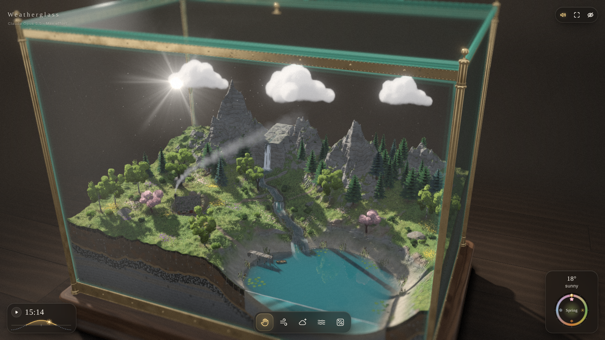

# Weatherglass — Claude Opus v5.5 · Max Effort

**A self-contained interactive 3D weather toy: a living miniature landscape sealed inside a brass-and-glass display case on a walnut plinth.**

> ### This version
> **Model:** Claude Opus v5.5
> **Effort:** Max
> **How:** one lead agent plus 10 sub-agents building in parallel, each owning one part (glass, brass and plinth, water, cabin and rocks, trees, meadow, animals, rain and lightning, sound, interface, input)
> **Build time:** ≈ 2 h 10 min from prompt to finished page
>
> **Live:** https://todsawat.github.io/weatherglass-Opus5.5-Max/
>
> One HTML file. No external images, models, fonts or audio: every texture, mesh, sound and interface element is generated in code at runtime.

## Three versions from one prompt

The same prompt ([PROMPT.md](PROMPT.md)) was built three times, by three different models. Each version has its own repository, its own Pages site and its own README so the results stay separate.

| # | Version | Hardware | Build time | Live | Repo |
|---|---|---|---|---|---|
| 1 | **Claude Opus v5.5 · Max Effort** | Anthropic cloud · lead + 10 parallel sub-agents | ≈ 2 h 10 min | [open](https://todsawat.github.io/weatherglass-Opus5.5-Max/) | **this repo** |
| 2 | DeepSeek v4.1 · FP8 Weight · Max Effort | 4× DGX Spark | 7 h 30 min (run 2) | [open](https://todsawat.github.io/weatherglass-DS41Flash-FP8-Max/) | [weatherglass-DS41Flash-FP8-Max](https://github.com/todsawat/weatherglass-DS41Flash-FP8-Max) |
| 3 | GLM v5.3 Flash · EXL3 4bpw · Max Effort | 2× DGX Spark | 55 min | [open](https://todsawat.github.io/weatherglass-GLM5.3Flash-EXL3-4bpw-Max/) | [weatherglass-GLM5.3Flash-EXL3-4bpw-Max](https://github.com/todsawat/weatherglass-GLM5.3Flash-EXL3-4bpw-Max) |

## What it is

A 12 × 8 × 9.2 miniature valley (five craggy peaks, a waterfall, a terraced river, a lake cut open by the front glass, a log cabin, a jetty and rowing boat, pines, oaks, birches and cherries, 20k–120k blades of grass, seasonal wildflowers, birds, butterflies, dragonflies, fireflies and fish) held inside a glass case with brass posts, riveted rails, a walnut plinth, an engraved plaque and a working humidity and temperature gauge.

Everything is connected. Clouds hold water: squeeze one and it rains, and the rain wets the ground, fills puddles, raises the lake and swells the waterfall. Merge two big wet clouds and they grow into a thunderstorm that strikes the tallest tree under it. Temperature comes from the season, the hour, the height and the weather, so it can snow on the peaks while it rains in the valley, and the lake, river and waterfall freeze in deep cold. Fog drains downhill and pools over the lake. The glass mists, beads, runs, frosts and can be wiped.

## Controls

- **Drag** empty space to orbit · **right-drag** orbit · **middle-drag** pan · **scroll / pinch** zoom · on touch, one finger for tools and orbiting, two fingers to zoom and orbit.
- **Hand (1 / H):** grab a cloud and drag it · **hold still** to squeeze out rain (or **scroll** over it) · **shake** it hard for lightning · **let go while moving** to fling it · push one cloud into another to merge them. Drag the **sun** or **moon** to change the time. Grab a tree to bend it, click to flick it. Click the lake to splash it (or crack the ice), tap the glass, tap the brass gauge.
- **Wind (2 / W):** sweep across the land. **Cloud (3 / C):** press in the sky to condense a cloud, hold to grow it, drag to paint its shape. **Fog (4 / F):** brush mist into the valley. **Wipe (5 / G):** rub the glass clear.
- **U** hides and shows the interface.
- Bottom left: play runs a whole day in five minutes; click or drag the sun curve to set the time. Bottom right: drag round the season dial, click a symbol to glide to it.

### Scenarios

Append `?scenario=` to the address:
`calm` · `rain` · `storm` · `snow` · `mountainsnow` · `fog` · `autumn` · `night` · `dusk`

Example: https://todsawat.github.io/weatherglass-Opus5.5-Max/?scenario=storm

Other flags: `q=0|1|2` forces the detail level · `tour=0` hides the first-run tips, `tour=reset` shows them again.

## How it was built

The lead agent first wrote the foundation: the render pipeline (shadow map, ray-marched air, clouds and fog, planar lake reflection, bloom, tilt-shift, grade), the terrain with its soil cross-section, the whole weather simulation, and the soft-body clouds. It then wrote an engineering contract ([docs/CONTRACT.md](docs/CONTRACT.md)) and handed one part each to 10 sub-agents working at the same time, then integrated, tuned colours against the reference values in the prompt, and checked every scenario.

## Repository layout

| Path | What |
|---|---|
| `index.html` | the whole app, built (open it directly; works offline) |
| `src/` | the source, one file per part, loaded in file-name order |
| `lib/three.min.js` | three.js r160 (MIT, see `lib/three.LICENSE`), inlined by the build |
| `build.cjs` | `node build.cjs` rebuilds `index.html` from `src/` |
| `PROMPT.md` | the original prompt |
| `docs/CONTRACT.md` | the engineering contract the parallel build followed |
| `tools/` | headless-browser checks: `shot.cjs` (simulate and screenshot), `run.cjs` (live mouse and keyboard tests), `multi.cjs`, `px.cjs`, `perf.cjs` (`npm install` first) |

## Notes

- WebGL 2 is required. Desktop and mobile (touch, drawer for the time and season panels on small screens).
- The detail level (grass 20k / 60k / 120k, trees, particles, shadow sharpness, the lake mirror, tilt-shift) is picked from the GPU, then the render resolution adapts to hold a smooth frame rate. Lower levels reduce counts but never remove a feature.
- The landscape is seeded and identical on every load. No network requests at runtime.
- Developed and checked in headless Chromium with software WebGL: all nine scenarios render without errors at all three detail levels and at phone size.
